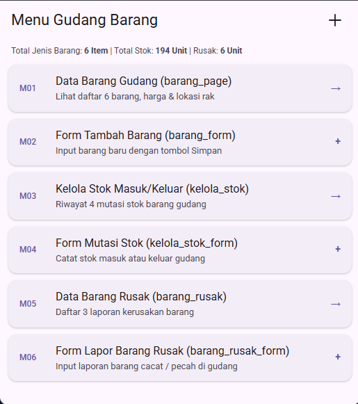

# 📦 Aplikasi Manajemen Inventaris Gudang (PMO 2026)

[](https://flutter.dev)
[](https://dart.dev)
[](https://flutter.dev)

Aplikasi mobile berbasis **Flutter** untuk pengelolaan inventaris, transaksi mutasi stok barang (masuk/keluar), serta pelaporan barang rusak di gudang. Proyek ini dikembangkan sebagai bagian dari praktikum mata kuliah **Pemrograman Mobile (PMO) 2026**.

---

## 📸 Antarmuka Menu Utama

<p align="center">
  
</p>

---

## 🚀 Fitur Utama

### 1. 🧭 Dashboard & Menu Utama (`GudangMenu`)
Halaman beranda (*landing page*) utama yang menyajikan ringkasan inventaris serta akses terpadu ke seluruh modul:
- **Ringkasan Statistik**: Menampilkan indikator total jenis barang, total unit stok gudang, dan jumlah barang rusak.
- **Pintasan Modul (M01 – M06)**:
  - **M01**: `Data Barang Gudang` (Navigasi ke `BarangPage`).
  - **M02**: `Form Tambah Barang` (Navigasi ke `BarangForm`).
  - **M03**: `Kelola Stok Masuk/Keluar` (Navigasi ke `KelolaStokPage`).
  - **M04**: `Form Mutasi Stok` (Navigasi ke `KelolaStokForm`).
  - **M05**: `Data Barang Rusak` (Navigasi ke `BarangRusakPage`).
  - **M06**: `Form Lapor Barang Rusak` (Navigasi ke `BarangRusakForm`).
- **Aksi Cepat**: Tombol `+` pada AppBar untuk membuka formulir penambahan barang baru dengan cepat.

### 2. 📋 Manajemen Data Barang
- **Daftar Barang (`BarangPage`)**: Menampilkan katalog barang di gudang lengkap dengan kode barang, nama barang, harga, dan stok unit.
- **Tambah Barang (`BarangForm`)**: Formulir penambahan data barang baru ke dalam sistem.
- **Detail Barang (`BarangDetail`)**: Menampilkan rincian data barang lengkap dengan tombol pintasan **+ Kelola Stok** dan **+ Lapor Rusak**.

### 3. 🔄 Kelola Stok Gudang (Mutasi Stok)
- **Riwayat Stok (`KelolaStokPage`)**: Menampilkan daftar mutasi stok (*Stok Masuk* & *Stok Keluar*).
- **Form Mutasi Stok (`KelolaStokForm`)**:
  - Input Kode Mutasi & Nama Barang.
  - Pilihan **Jenis Mutasi** menggunakan *Dropdown / Combobox* (`Masuk` / `Keluar`).
  - Input **Jumlah Unit** dengan validasi khusus tipe angka (*digits only*).
- **Detail Mutasi Stok (`KelolaStokDetail`)**: Menampilkan rincian mutasi stok yang tersimpan.

### 4. ⚠️ Manajemen Barang Rusak
- **Daftar Barang Rusak (`BarangRusakPage`)**: Menampilkan riwayat laporan kerusakan barang menggunakan widget `ItemBarangRusak`.
- **Form Lapor Rusak (`BarangRusakForm`)**: Formulir pencatatan laporan kerusakan barang beserta keterangan kerusakan dan jumlah unit terdampak.
- **Detail Barang Rusak (`BarangRusakDetail`)**: Menampilkan rincian laporan kerusakan barang secara mendalam.

---

## 📂 Struktur Proyek

```text
flutter_pmo_2026/
├── lib/
│   ├── main.dart                 # Entry point aplikasi (Root: GudangMenu)
│   └── ui/
│       ├── gudang_menu.dart          # Halaman beranda / menu utama gudang (M01 - M06)
│       ├── barang_page.dart          # Halaman daftar data barang gudang
│       ├── barang_form.dart          # Form tambah data barang
│       ├── barang_detail.dart        # Halaman detail rincian data barang
│       ├── kelola_stok.dart          # Riwayat mutasi stok gudang
│       ├── kelola_stok_form.dart     # Form input mutasi stok gudang (combobox & digits only)
│       ├── kelola_stok_detail.dart   # Detail data mutasi stok
│       ├── barang_rusak.dart         # Daftar laporan barang rusak
│       ├── barang_rusak_form.dart    # Form pelaporan barang rusak
│       ├── barang_rusak_detail.dart  # Detail laporan barang rusak
│       └── ...
├── menu_gudang_barang.png        # Screenshot referensi desain menu gudang
├── pubspec.yaml                  # Konfigurasi dependensi project Flutter
└── README.md                     # Dokumentasi proyek
```

---

## 🛠️ Prasyarat & Instalasi

Pastikan Anda telah menginstal:
- [Flutter SDK](https://docs.flutter.dev/get-started/install) (versi 3.x ke atas)
- [Dart SDK](https://dart.dev/get-dart)
- Android Studio / VS Code dengan ekstensi Flutter & Dart

### Langkah Menjalankan Aplikasi

1. **Clone repositori**:
   ```bash
   git clone <url-repo-anda>
   cd flutter_pmo_2026
   ```

2. **Unduh dependensi**:
   ```bash
   flutter pub get
   ```

3. **Jalankan aplikasi**:
   ```bash
   flutter run
   ```

4. **Analisis kode (Opsional)**:
   ```bash
   flutter analyze
   ```

---

## 👨‍💻 Teknologi yang Digunakan
- **Framework**: [Flutter](https://flutter.dev/)
- **Bahasa Pemrograman**: [Dart](https://dart.dev/)
- **Desain & UI**: Material Design 3
